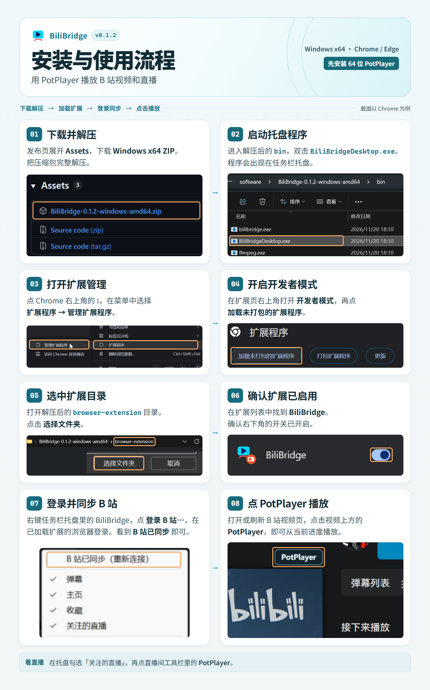

# BiliBridge

在 Windows 上把 B 站视频交给 PotPlayer，使用本机的 SVP 配置。桌面程序常驻托盘，菜单包含 **登录 B 站、弹幕、主页、收藏、关注的直播、开机自启** 和 **退出**。

## 启动

先安装 64 位 PotPlayer。从 [GitHub Releases](https://github.com/kuuhaku1314/BiliBridge/releases/latest) 下载 `BiliBridge-*-windows-amd64.zip` 并完整解压。在解压后的目录中，双击 `bin/BiliBridgeDesktop.exe` 启动托盘程序。

<details>
<summary>查看安装与使用流程图</summary>



</details>

**Windows 发布包已内置 FFmpeg**，用于命令行的 `-hls` 模式。解压后即可使用，无需另行安装或配置 `PATH`。

首次启动会登记 Chrome / Edge 的本机消息入口，并自动为 PotPlayer 添加 **B站首页**、**我的收藏** 和 **我关注的直播** 三个原生外部专辑。PotPlayer 正在运行时，专辑文件在它退出后更新。按 F6 查看右侧播放列表，在对应专辑的右键菜单中可切换「样式 → 显示缩略图 + 4 行信息」。直播专辑只显示正在开播的关注房间，可打开 B 站提供的 FLV 直播源。直播起播前会尝试预缓冲 6 秒内容，最多等待 10 秒或缓存 12 MiB。

在托盘菜单勾选 **开机自启** 后，BiliBridge 会在当前 Windows 用户登录时启动。再点一次可关闭。

在 Chrome 或 Edge 的扩展管理页开启开发者模式，使用「加载已解压的扩展程序」选择解压后的 `browser-extension/` 目录，再打开或刷新已登录的 B 站网页。播放器上方靠右的 **PotPlayer** 按钮会从网页当前进度起播。已有 PotPlayer 窗口时会在该窗口切换视频。成功后网页播放器会暂停。

直播间播放器上方也有 **PotPlayer** 按钮。启用托盘里的「关注的直播」后，网页按钮会优先请求当前直播清晰度，实际档位由 B 站返回。从 PotPlayer 的直播列表直接打开时默认请求原画。列表优先使用直播间封面。

从托盘菜单选择 **登录 B 站**，在已安装扩展的 Chrome 或 Edge 里完成网页登录。已有登录状态时，打开页面即可同步。托盘显示 **B 站已同步** 后，可直接在 PotPlayer 打开首页、收藏和直播专辑。登录 Cookie 通过浏览器本机消息交给托盘，只保存在运行内存。收藏专辑按收藏时间汇总各收藏夹，最多显示 200 条视频。会员播放范围由 B 站返回的账号权限决定，支持可访问的 DASH 视频和剧集。

弹幕从 B 站分段读取，独立覆盖在 PotPlayer 窗口上。弹幕开关即时生效，普通滚动、顶部、底部和逆向弹幕可显示。显示区域按播放器客户区和视频宽高比计算，动画跟随所在显示器刷新率。

桌面播放把 B 站原始视频和音频作为独立的本地流交给 PotPlayer，读取时会预加载后续片段。首页和收藏使用 DASH 清单关联两条流。网页启动时等待播放器起播，再续播到网页位置。SVP 由本机配置决定何时处理。

## 命令行与 FFmpeg

在解压后的目录中，可以直接使用发布包里的命令行程序播放视频。

```powershell
.\bin\bilibridge.exe "https://www.bilibili.com/video/BV1wRsV6gEP4"
```

用 `-hls` 启动时，BiliBridge 会用 FFmpeg 按需封装 H.264/AAC 流。程序优先查找与 `bilibridge.exe` 同目录的 `ffmpeg.exe`，然后查找 `PATH`。解压 Windows 发布包后，可以直接运行以下命令。

```powershell
.\bin\bilibridge.exe -hls "https://www.bilibili.com/video/BV1wRsV6gEP4"
```

自行构建 BiliBridge 时，可以将 Windows 版 `ffmpeg.exe` 放进 `bin` 目录，或使用系统 `PATH` 上已有的 FFmpeg。内置构建使用 LGPL 2.1 或更新版本，许可证位于 `licenses/`，对应源码见发布页附件。 [FFmpeg 下载页](https://ffmpeg.org/download.html#build-windows)

## 从源码构建

在 Windows 上用 Go 1.26.11 构建。

```powershell
go build -trimpath -ldflags=-H=windowsgui -o bin/BiliBridgeDesktop.exe ./cmd/bilibridge
go build -trimpath -o bin/bilibridge.exe ./cmd/bilibridge
```
